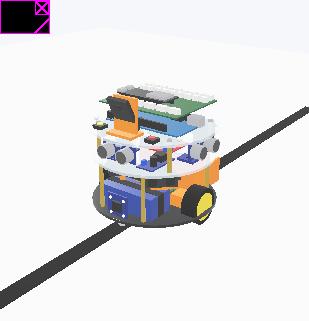

# Phase 02 – Final Round: "The Nine Seals of Pera"

PeraBots 2026, University category, final round (physical robot) – team AProbotix.

Our robot is **GuardianBot v3**: a 150 mm round robot built from the parts the team owns.

- **Controllers:** Arduino Mega 2560 (real-time I/O), an ESP32-S3 (mission brain) and an ESP32-CAM (the eye: sees maze tiles 1–2 cells ahead).
- **Drive:** L298N with two N20 encoder motors, on a 3S LiPo.
- **Sensors:**
  - 4 × HC-SR04 ultrasonic
  - 5 × Sharp GP2Y0A21 IR
  - 2 × TCS3200 colour (one for floor tiles, one for piece colour)
  - 5-ch TCRT5000 line array
  - MPU6050
- **Gripper:** a rear capture pocket with two Kpower M0170 servo arms.

All the hardware (Webots model, laser-cut decks, 3-D prints) is generated from one file of
dimensions, `hardware/cad/guardianbot_geometry.py`.



**Start here: [`docs/GuardianBot_v3_build_guide.md`](docs/GuardianBot_v3_build_guide.md).** It covers the parts,
the Sri Lankan shopping list (under Rs 15,000), power and wiring, the pin map, the build order,
calibration and the competition procedure.

| What | Where |
|---|---|
| Arduino Mega firmware (body: encoders, wheel PID, gyro, sonar/IR/line/colour, servos, link) | `firmware/mega_body/` |
| ESP32-S3 firmware (brain: Sections 1–3, the same strategy as the simulation) | `firmware/esp32s3_brain/` |
| ESP32-CAM firmware (48 × 32 RGB grid to the brain at ~15 fps) | `firmware/esp32cam_vision/` |
| Software-in-the-loop: the real ESP32 C++ drives the Webots robot | `firmware/sil/` + `simulation/controllers/mega_sil/` |
| Host compile check of both sketches | `firmware/hostcheck/check.sh` |
| **Mega shield PCB** (all wiring, keyed connectors, ESP32-S3 plugs in; through-hole, for a local PCB shop) | `hardware/pcb_v3/`, made by `hardware/cad/shield_v3/` |
| **Every earlier version + comparison website** (bodies, PCBs, budget, speed, weight, parts) | `versions/` (website: `versions/_site/index.html`, also on GitHub Pages) |

Latest Webots results, 0 collisions in every run:

| Run | END reached |
|---|---|
| Python controller + camera, full mission | 153 s |
| ESP32 firmware + emulated ESP32-CAM (software-in-the-loop, real-robot accelerations), full mission | 187.8 s |
| ESP32 firmware, Section 3 restart with no saved clues (inspects the board, reads pieces with the front colour sensor) | 129 s |

## Folder map

| Folder | What is inside |
|---|---|
| `docs/` | Final-round rulebook (PDF and extracted text), **`GuardianBot_v3_build_guide.md`**, robot renders, rulebook figures, sample run log |
| `simulation/` | Webots R2025a project: arena, robot, controllers |
| `simulation/worlds/` | `perabots_arena.wbt` (full mission), `section3_start.wbt` (restart at Section 3), `guardian_hw_test.wbt` (gripper/sensor self-test), `Arena.wbt` (same as perabots_arena) |
| `simulation/protos/` | `Arena.proto` (Section 3 rebuilt from rulebook Figure 1), `Obstacles.proto`, `GuardianBot.proto` (generated) |
| `simulation/controllers/` | `main_controller` (Sections 1, 2, 3; writes `run_log.txt` and `clues.json`), `mega_sil` (runs the ESP32 firmware in the loop) and `guardian_hw_test` |
| `simulation/make_guardianbot.py`, `make_world.py` | Regenerate the robot PROTO / the worlds |
| `simulation/tools/` | `rebuild_section3.py`: rewrites the Section 3 part of `Arena.proto` |
| `firmware/` | Robot firmware (see above) |
| `hardware/cad/` | Generator scripts: `guardianbot_geometry.py` (all dimensions), `make_acrylic_dxf.py`, `make_printed_parts.py`, `autoroute.py` (PCB router), `shield_v3/` (Mega shield: parts + nets, placement, routing, Gerbers, schematic, render) |
| `hardware/acrylic/` | Laser-cut DXF + STL: base, mid and top decks (3 mm), and all three on one sheet |
| `hardware/3d_prints/` | STL and STEP for the 14 printed parts (v3, including the camera mast) |
| `hardware/pcb_v3/` | Mega shield: KiCad project, schematic PDF, Gerbers zip, toner-transfer PDFs, BOM, positions, DRC report, render |
| `analysis/` | Early investigation scripts (maze/obstacle extraction from the rulebook and the Phase 01 arena, frame checks) and the images extracted from the rulebook |
| `versions/` | Every earlier version (v1.0, v1.1, v2.0 incl. its PCB, v3.0 Mega-only draft) + a `spec.yaml` for every version, the neutral judge used to time them, and the comparison website |

## Run the simulation

1. Open `simulation/worlds/perabots_arena.wbt` in Webots R2025a.
2. Press run (fast mode recommended). The controller prints its progress and also writes
   `simulation/controllers/main_controller/run_log.txt`.

Last full run (v3 + camera): Section 1 at 18.5 s, maze explored at 56 s (3 blue + 2 green tiles),
cylinder placed in position 7, END reached at 153 s, 0 collisions.

**Run the real firmware in Webots (software-in-the-loop).**

1. Build the brain with `firmware/sil/build_sil.sh` (Linux, WSL or MinGW g++).
2. Set the robot's `controller` to `mega_sil`.
3. Run as usual. The brain's log goes to `simulation/controllers/mega_sil/sil_log.txt`.

`section3_start.wbt` starts the robot in the maze exit cell. It uses the clues saved in
`clues.json`, as the real robot would after a judge-ordered restart.

## Regenerate files

```
cd simulation
python make_guardianbot.py      # protos/GuardianBot.proto
python make_world.py            # worlds/*.wbt

cd ../hardware/cad
python shield_v3/make_shield.py route && python shield_v3/make_shield.py fab   # Mega shield PCB (KiCad 7 python)
python shield_v3/make_shield_schematic.py                                      # its schematic
python make_acrylic_dxf.py      # ../acrylic/*.dxf + .stl     (needs: pip install cadquery ezdxf)
python make_printed_parts.py    # ../3d_prints/*.stl/.step    (needs: pip install cadquery)
```

Change a dimension in `hardware/cad/guardianbot_geometry.py`, then rerun the generators.
The robot model, acrylic and prints stay consistent with each other.

## Key facts from the rulebook

- Arena 2.44 × 3.66 m in 3 sections. Section 3 has a 3 × 3 board (122 × 92 cm, 2 cm lines),
  with green/blue collection pads and END at the far side.
- Clues: blue tiles → Cylinder 1, green tiles → Cube 1, right turns → Cylinder 2, left turns → Cube 2.
  Positions follow the Lo Shu magic square: 1 is the middle of the entrance row, 6 is on the robot's left.
- Robot must fit 20 × 20 × 20 cm. A 2-minute calibration with a CAL button is allowed.
  You get 3 attempts in 15 minutes.
