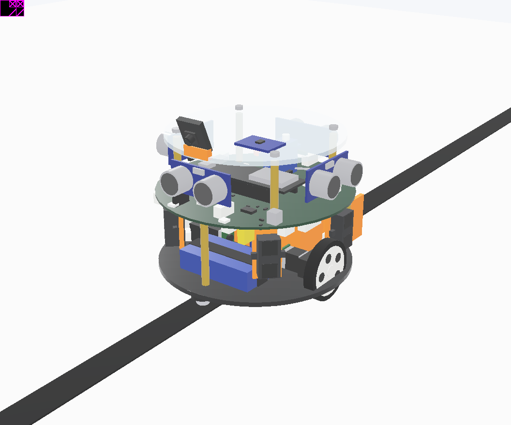

# Phase 02 – Final Round: "The Nine Seals of Pera"

PeraBots 2026, University category, final round (physical robot) – team AProbotix.

Our robot is **GuardianBot**, a 130 mm round robot. It has a rear capture pocket with a
servo gripper, 4 × HC-SR04 ultrasonic sensors, 4 × Sharp GP2Y0A41 IR sensors, an 8-channel
line array, a camera for the tiles, and an ESP32-S3.
Everything here (Webots model, laser-cut acrylic, 3-D prints, main PCB) is generated from one
shared set of dimensions, `hardware/cad/guardianbot_geometry.py`.



## Folder map

| Folder | What is inside |
|---|---|
| `docs/` | Final-round rulebook (PDF and extracted text). **`GuardianBot_build_guide_and_BOM.md`** has the parts list, wiring, pin map and build order. Also renders of the robot, rulebook figures, and a sample run log |
| `simulation/` | Webots R2025a project: arena, robot, controllers |
| `simulation/worlds/` | `perabots_arena.wbt` (full mission), `section3_start.wbt` (restart at Section 3), `guardian_hw_test.wbt` (gripper/sensor self-test), `Arena.wbt` (same as perabots_arena) |
| `simulation/protos/` | `Arena.proto` (Section 3 rebuilt from rulebook Figure 1), `Obstacles.proto`, `GuardianBot.proto` (generated) |
| `simulation/controllers/` | `main_controller` (Sections 1, 2, 3; writes `run_log.txt` and `clues.json`) and `guardian_hw_test` |
| `simulation/make_guardianbot.py`, `make_world.py` | Regenerate the robot PROTO / the worlds |
| `simulation/tools/` | `rebuild_section3.py`: rewrites the Section 3 part of `Arena.proto` |
| `hardware/cad/` | Generator scripts: `guardianbot_geometry.py` (all dimensions), acrylic DXF, 3-D parts, PCB (netlist, placement, autorouter, schematic) |
| `hardware/acrylic/` | Laser-cut DXF: 3 mm black base, 3 mm clear crown, combined sheet |
| `hardware/3d_prints/` | STL and STEP for the 10 printed parts, plus a preview image |
| `hardware/pcb/` | KiCad 7 main board (`.kicad_pro/.kicad_sch/.kicad_pcb`), schematic PDF, DRC report, BOM and placement CSVs, 3-D STEP, Gerbers, and **`guardianbot_main_gerbers_JLCPCB.zip`** ready to order |
| `analysis/` | Early investigation scripts (maze/obstacle extraction from the rulebook and the Phase 01 arena, frame checks) and the images extracted from the rulebook |
| `archive/` | Earlier robot versions, kept for reference: `v1_TwoWheelRobot` (first attempt) and `v1_GuardianBot_ToF` (ToF-sensor version), plus the v2 project zip |

## Run the simulation

1. Open `simulation/worlds/perabots_arena.wbt` in Webots R2025a.
2. Press run (fast mode recommended). The controller prints its progress and also writes
   `simulation/controllers/main_controller/run_log.txt`.

Last full run: Section 1 at 25.9 s, maze explored at 84.8 s (3 blue + 2 green tiles),
cylinder placed in position 7, END reached at 181.6 s, 0 collisions
(`docs/sample_full_run_log.txt`).

`section3_start.wbt` starts the robot in the maze exit cell. It uses the clues saved in
`clues.json`, as the real robot would after a judge-ordered restart.

## Regenerate files

```
cd simulation
python make_guardianbot.py      # protos/GuardianBot.proto
python make_world.py            # worlds/*.wbt

cd ../hardware/cad
python make_acrylic_dxf.py      # ../acrylic/*.dxf            (needs: pip install ezdxf)
python make_printed_parts.py    # ../3d_prints/*.stl/.step    (needs: pip install cadquery)
python make_pcb.py place        # ../pcb/*.kicad_pcb          (KiCad 7 python; set FP in pcb_design.py)
python autoroute.py             # routes the board + GND pours
python make_schematic.py        # ../pcb/*.kicad_sch
```

Change a dimension in `hardware/cad/guardianbot_geometry.py`, then rerun the generators.
The robot model, acrylic, prints and PCB stay consistent with each other.

## Key facts from the rulebook

- Arena 2.44 × 3.66 m in 3 sections. Section 3 has a 3 × 3 board (122 × 92 cm, 2 cm lines),
  with green/blue collection pads and END at the far side.
- Clues: blue tiles → Cylinder 1, green tiles → Cube 1, right turns → Cylinder 2, left turns → Cube 2.
  Positions follow the Lo Shu magic square: 1 is the middle of the entrance row, 6 is on the robot's left.
- Robot must fit 20 × 20 × 20 cm. A 2-minute calibration with a CAL button is allowed.
  You get 3 attempts in 15 minutes.
