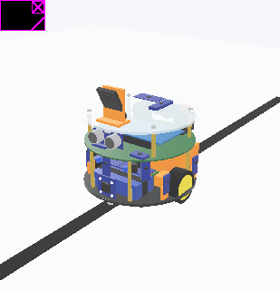

# Phase 02 – Final Round: "The Nine Seals of Pera"

PeraBots 2026, University category, final round (physical robot) – team AProbotix.

Our robot is **GuardianBot v4**: a 150 mm round robot built from the parts the team really owns.

- **Controllers:**
  - Arduino Mega 2560: real-time body, mounted upside-down on the PCB deck.
  - ESP32-CAM: brain on core 1, camera on core 0. It sees maze tiles 1–2 cells ahead.
- **Drive:** DRV8833 with two 6 V 300 rpm N20 encoder motors, on a 2S LiPo.
- **Sensors:**
  - 8 × VL53L0X time-of-flight: front, ±45°, two per side for wall alignment, back
  - 2 × HC-SR04
  - 2 × TCS3200 colour: floor tiles and piece colour
  - Pololu QTR-8RC line array
  - L3G4200D gyro
- **User interface:** 1 × 4 keypad and a 128 × 32 OLED.
- **Gripper:** a rear capture pocket with two Kpower M0170 servo arms.
- **Middle floor:** a PCB that carries all the wiring, with keyed JST-XH sockets. A vero board can replace it.

Everything physical is generated from one file of dimensions, `hardware/cad/guardianbot_geometry.py`: the Webots model, the laser-cut decks and the 3-D prints.



**Start here: [`docs/GuardianBot_v4_build_guide.md`](docs/GuardianBot_v4_build_guide.md).** It covers:

- what changed from v3, and why
- the parts
- the Sri Lankan shopping list (about Rs 20,000; about Rs 15,500 with a vero board)
- the PCB deck and power wiring
- the pin map
- the build order, calibration and the competition procedure

| What | Where |
|---|---|
| Arduino Mega firmware (body: encoders, wheel PID, gyro, 8 ToF, line, sonar, colour, servos, keypad, OLED, link) | `firmware/mega_body/` |
| ESP32-CAM firmware (brain: Sections 1–3, the same strategy as the simulation, plus the camera task) | `firmware/esp32cam_brain/` |
| Software-in-the-loop: the real ESP32 C++ drives the Webots robot | `firmware/sil/` + `simulation/controllers/mega_sil/` |
| Host compile check of both sketches | `firmware/hostcheck/check.sh` |
| **PCB mid deck** (144 mm round, through-hole, for a local PCB shop) | `hardware/pcb_v4/`, made by `hardware/cad/deck_v4/` |
| **Every earlier version + comparison website** (bodies, PCBs, budget, speed, weight, parts) | `versions/` (website on GitHub Pages, with a 3-D viewer for the PCBs, printed parts and decks) |

Latest Webots results, 0 collisions in every run:

| Run | Section 1 | Maze done | END reached |
|---|---|---|---|
| Python controller, full mission, timed by the neutral judge | 24.1 s | 61.6 s | **153.6 s** |
| ESP32-CAM firmware + emulated Mega and camera (software-in-the-loop), full mission | 33.2 s | 75.3 s | **170.3 s** |
| ESP32-CAM firmware, Section 3 restart with the saved clues | | | **131.5 s** |

## Folder map

| Folder | What is inside |
|---|---|
| `docs/` | Final-round rulebook (PDF and extracted text), **`GuardianBot_v4_build_guide.md`**, robot renders, rulebook figures, sample run log |
| `simulation/` | Webots R2025a project: arena, robot, controllers |
| `simulation/worlds/` | `perabots_arena.wbt` (full mission), `section3_start.wbt` (restart at Section 3), `guardian_hw_test.wbt` (gripper/sensor self-test), `Arena.wbt` (same as perabots_arena) |
| `simulation/protos/` | `Arena.proto` (Section 3 rebuilt from rulebook Figure 1), `Obstacles.proto`, `GuardianBot.proto` (generated) |
| `simulation/controllers/` | `main_controller` (Sections 1, 2, 3; writes `run_log.txt` and `clues.json`), `mega_sil` (runs the ESP32 firmware in the loop) and `guardian_hw_test` |
| `simulation/make_guardianbot.py`, `make_world.py` | Regenerate the robot PROTO / the worlds |
| `simulation/tools/` | `rebuild_section3.py`: rewrites the Section 3 part of `Arena.proto` |
| `firmware/` | Robot firmware (see above) |
| `hardware/cad/` | Generator scripts: `guardianbot_geometry.py` (all dimensions), `make_acrylic_dxf.py`, `make_printed_parts.py`, `autoroute.py` (PCB router), `deck_v4/` (PCB deck: parts + nets, placement, routing, Gerbers, schematic, render) |
| `hardware/acrylic/` | Laser-cut DXF + STL: base and top decks (3 mm), the vero-fallback mid deck, and all three on one sheet |
| `hardware/3d_prints/` | STL and STEP for the 15 printed part types (ToF posts, camera mast, gripper, pocket, ...) |
| `hardware/pcb_v4/` | PCB mid deck: KiCad project, schematic PDF, Gerbers zip, toner-transfer PDFs, BOM, positions, DRC report, render |
| `analysis/` | Early investigation scripts (maze/obstacle extraction from the rulebook and the Phase 01 arena, frame checks) and the images extracted from the rulebook |
| `versions/` | Every earlier version with a `spec.yaml` (v1.0 … v4.0) and its files: e.g. v2.0 with its PCB, v3.3 with the ESP32-S3 firmware, the Mega shield PCB and the v3 guide. Also the neutral judge used to time them, and the comparison website |

## Run the simulation

1. Open `simulation/worlds/perabots_arena.wbt` in Webots R2025a.
2. Press run (fast mode recommended). The controller prints its progress and also writes
   `simulation/controllers/main_controller/run_log.txt`.

Last full run (v4): Section 1 at 24 s, maze done at 62 s (3 blue + 2 green tiles),
piece placed in position 7, END reached at 153.6 s, 0 collisions.

**Run the real firmware in Webots (software-in-the-loop).**

1. Build the brain with `firmware/sil/build_sil.sh` (Linux, WSL or MinGW g++).
2. Set the robot's `controller` to `mega_sil`.
3. Run as usual. The brain's log goes to `simulation/controllers/mega_sil/sil_log.txt`.

`section3_start.wbt` starts the robot in the maze exit cell. It uses the clues saved in
`clues.json`, as the real robot would after a judge-ordered restart.

## Regenerate files

```
cd simulation
python make_guardianbot.py      # protos/GuardianBot.proto
python make_world.py            # worlds/*.wbt

cd ../hardware/cad
python deck_v4/make_deck.py route                     # PCB mid deck: place + autoroute (KiCad 7 python, shapely)
python deck_v4/fix_unrouted.py --rip-gnd --clr 0.2    # finish the last connections, re-route GND, DRC
python deck_v4/make_deck.py fab                       # Gerbers, drill, toner PDFs, BOM
python deck_v4/make_deck_schematic.py                                 # its schematic
python make_acrylic_dxf.py      # ../acrylic/*.dxf + .stl     (needs: pip install cadquery ezdxf shapely)
python make_printed_parts.py    # ../3d_prints/*.stl/.step    (needs: pip install cadquery)
```

Change a dimension in `hardware/cad/guardianbot_geometry.py`, then rerun the generators.
The robot model, acrylic and prints stay consistent with each other.

## Key facts from the rulebook

- Arena 2.44 × 3.66 m in 3 sections. Section 3 has a 3 × 3 board (122 × 92 cm, 2 cm lines),
  with green/blue collection pads and END at the far side.
- Clues: blue tiles → Cylinder 1, green tiles → Cube 1, right turns → Cylinder 2, left turns → Cube 2.
  Positions follow the Lo Shu magic square: 1 is the middle of the entrance row, 6 is on the robot's left.
- Robot must fit 20 × 20 × 20 cm. A 2-minute calibration with a CAL button is allowed (keypad K4).
  You get 3 attempts in 15 minutes.
