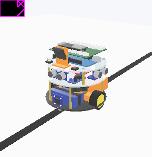
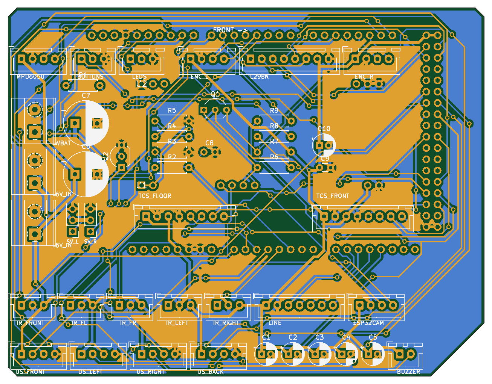
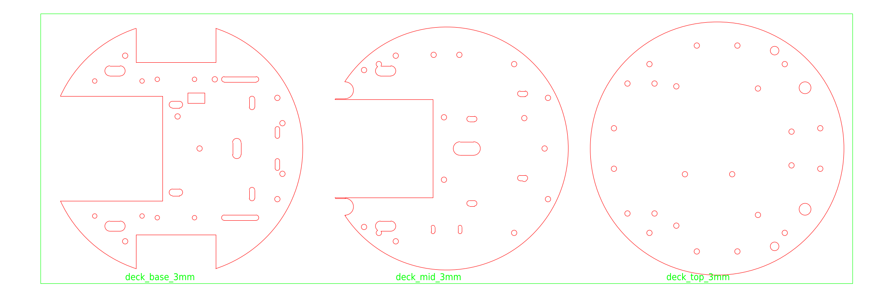

# GuardianBot v3 – final build guide

PeraBots 2026 University Final, *The Nine Seals of Pera*, team AProbotix.

This is the robot we build for the final round. It uses the parts the team already has. The short
shopping list in section 3 stays well inside the Rs 15,000 budget.



## 1. The design in one page

| Arena fact | What the robot does |
|---|---|
| Size limit 20 × 20 × 20 cm. Maze cells are 238 mm wide inside | 150 mm round robot, 120 mm tall, so it has 44 mm of space on each side in a maze cell. The wheels sit on the centre line, so it turns on the spot |
| Obstacle field with an unknown layout | A 2 cm occupancy grid, built from 4 HC-SR04 + 5 Sharp IR sensors. A* path planning with a clearance cost, 45° straight segments, and position fixes from the walls |
| Tiles are only in dead-end cells, and the room light can change | An **ESP32-CAM** on a front mast (lens 140 mm up, tilted 29° down) sees the floor of the cells 1–2 ahead, through open walls only. The robot just has to *look* into a possible dead end, not drive into it. The TCS3200 under the robot (8 mm above the floor, own white LEDs) gives a strong extra vote for the cell it is standing in, so lighting can't fool both |
| 9 × 4 maze; count the left/right turns of the shortest path | Every sensor ray votes on the maze walls. Exploration is Dijkstra over (cell, heading), pulled towards the exit. The turn count comes from Dijkstra on (fewest cells, then fewest turns) |
| Nine-Point Board, 20 mm black lines | 5-ch TCRT5000 array 45 mm ahead of the axle. It follows lines and corrects position at line crossings. The robot moves on a graph of the board lines |
| 50 mm cube or cylinder | Rear capture pocket (55 mm throat) and two arms, each on its own Kpower M0170 servo. The pocket gets backed over the piece |
| Clues may not be enough | The robot drives the two inner board lines. The side Sharp sensors find the occupied cells, and the front TCS3200 reads the colour of any piece it is unsure about |
| Judges may restart a run at Section 3 | Clues are saved in ESP32-S3 flash (NVS). Hold CAL and press START to restart at Section 3 |
| Rule 4.2 (no remote control) | Everything runs on board. The ESP32-S3 radio is never switched on, and the link is a wire (UART) |

**Two controllers, one job each.**

- The **Arduino Mega 2560** is the *body*. It handles encoders on interrupts, the wheel speed PID at 100 Hz, the gyro at 200 Hz, the sonars and colour sensors without blocking, the servos, the buttons and the battery monitor.
- The **ESP32-S3** is the *brain*: the whole mission strategy, in C++.
- The **ESP32-CAM** is the *eye*. It crops each frame to the brain's field of view, averages it to a 48 × 32 grid and streams it at about 15 fps (UART, 921600 baud). The brain classifies the colours and projects them onto the maze floor, with the same code as the simulation.

Every 20 ms the Mega sends one binary telemetry frame and the ESP32 answers with one command frame
(`firmware/mega_body/protocol.h`). If the brain goes quiet for 250 ms, the Mega stops the motors.

**Proof that it works.** The same strategy runs in Webots, in two ways:

- `simulation/controllers/main_controller`, in Python.
- **The real ESP32 C++ firmware itself**, compiled for the PC and driven by a Python "Mega emulator" (`simulation/controllers/mega_sil`). This is a software-in-the-loop test.

Latest results, with 0 collisions in every run:

| Run | Section 1 | Maze explored | END reached |
|---|---|---|---|
| Python controller + camera, full mission | 18.5 s | 57 s (3 blue + 2 green tiles, correct) | **153 s** |
| ESP32 firmware + emulated ESP32-CAM (software-in-the-loop, real-robot accelerations), full mission | 41 s | 89 s | **187.8 s** |
| (before the camera, for comparison) Python controller | 18.5 s | 87 s | 183.7 s |
| ESP32 firmware, Section 3 restart with no saved clues | | | 129 s (inspected the board and read 3 pieces with the front colour sensor) |

## 2. Parts the team already has (all used)

| Part | Qty | Job |
|---|---|---|
| Arduino Mega 2560 | 1 | body: real-time I/O |
| ESP32-S3 DevKitC (2 × USB-C) | 1 | brain: mission logic, clue storage (NVS) |
| L298N | 1 (+1 spare) | drives the N20 motors. **Remove the 5 V regulator jumper**: logic power comes from the 5.1 V buck |
| N20 12 V encoder gear motors (~300 rpm, 1:100) + 43 mm wheels | 2 | drive. The 37D motors are too long for a 150 mm robot |
| 3S LiPo 11.1 V 1000–1500 mAh, XT60 | 1 | power. Drawing about 1 A on average, it lasts more than 45 minutes |
| HC-SR04 | 4 | front, left, right and back. Used for close stops and wall fixes |
| Sharp GP2Y0A21YK0F (10–80 cm) | 5 | front, ±45°, left and right (the side pair sits back to back on a centre plate) |
| TCS3200 / GY-31 | 2 | one looks at the floor (tiles); one looks forward (piece colour) |
| 5-ch TCRT5000 line array | 1 | Section 3 lines |
| MPU6050 | 1 | gyro Z, for the heading |
| Kpower M0170 metal servo | 2 | one per gripper arm |
| LM2596 bucks | 2 | 5.1 V logic and sensors, 6.0 V servos (use the green one with the display to set the voltages) |
| 4-ch logic level shifter | 1 | only for the vero-board fallback; the shield has its own link circuit |
| Ball caster | 1 | front support |
| LiPo checker / buzzer | 1 | stays on the balance lead |
| 3D printer + laser cutter | – | the decks and the 14 printed part types |

## 3. Shopping list (Sri Lanka, under Rs 15,000)

Online prices are from tronic.lk (island-wide delivery) in Nov 2026; "≈" marks an estimate.
Shops you can visit in person: Lasertronics and the other Pettah shops (Colombo), Sanjeewa Electronics
(Kandy City Centre), and lk-tronics.com / duino.lk online.
**Tick "have it?" before you buy.** Several of these may already be in the lab.

| # | Item | Qty | Price (LKR) | Have it? |
|---|---|---|---|---|
| 1 | XT60 pair with 14 AWG wire | 1 | 370 | |
| 2 | SPDT toggle switch 6 A (BU0060) (the rocker switch is out of stock) | 1 | ≈150 | |
| 3 | Inline blade-fuse holder + 5 A fuse (protects the LiPo from a short) | 1 | ≈250 | |
| 4 | M3 bolt + nut packs: 3×8 mm ×4, 3×12 mm ×2, 3×30 mm ×1 (Rs 30–50 each) | 7 packs | ≈260 | |
| 5 | M2.5 × 10 bolts + nuts (N20 clamps, pocket, caster) | 1 pack | ≈100 | |
| 6 | M3 threaded rod, 1 m (cut into 4 × 70 mm and 4 × 45 mm for the deck columns) | 1 | ≈200 | |
| 7 | M3 brass heat-set inserts (10 pcs, TA1187) | 1 | ≈150 | |
| 8 | Heat-shrink kit | 1 | 620 | |
| 9 | Capacitors: 10 µF ×6 (one per Sharp + the MPU), 470 µF 16 V ×2 (servo rail, L298N), 100 nF ×6 (motor terminals) | 1 set | ≈350 | |
| 10 | 6 mm panel push buttons (START, CAL), 5 mm blue + green LEDs, 330 Ω ×2, 5 V active buzzer + BC547 + 1 kΩ | 1 set | ≈300 | |
| 11 | Resistors 20 kΩ + 10 kΩ (battery divider to A5) | 1 set | ≈20 | |
| 12 | **Mega shield PCB, made by a local PCB shop** from `hardware/pcb_v3/guardianbot_v3_mega_shield_gerbers.zip` (2 layers, 107 × 83 mm, through-hole). Get a quote first; Rs 3,000 is an estimate | 1 | ≈3,000 | |
| 13 | JST-XH pre-wired plug + PCB socket sets (tronic.lk Rs 20–60 each): 2-pin ×1, 3-pin ×7, 4-pin ×9, 7-pin ×1, 8-pin ×3 | 21 | ≈900 | |
| 14 | Shield parts: 5.08 mm 2-pin screw terminal ×3, Arduino stackable/long male headers (8-pin ×6, 10-pin ×1, 2×18 ×1), 1 female 40-pin strip (ESP32 socket pieces), 2N7000, 470 µF ×2, 100 µF, 100 nF ×2, resistors 1.8k/3.3k/10k ×2/330 ×2 | 1 set | ≈700 | |
| 15 | Silicone wire 20 AWG red + black, 2 m each | 1 | ≈300 | |
| 16 | 3 mm acrylic, 500 × 200 mm offcut (all 3 decks fit on it; 3 mm plywood/MDF also works) | 1 | ≈1,500 | |
| 17 | Hook-and-loop strap 20 mm (battery) | 1 | ≈150 | |
| 18 | **ESP32-CAM OV2640** (MD0424; listed as discontinued, last units in stock – the OV3660 version works the same) | 1 | 3,930 | |
| 19 | **ESP32-CAM adapter board** (USB programmer + 5 V, MD0699) | 1 | 450 | |
| | **Essentials total (camera + Mega shield PCB)** | | **≈13,750** | |
| 20 | Spare LiPower 3S 1550 mAh 100C XT60 (in stock) – only if the budget allows: with the PCB it brings the total to about Rs 18,200 | 1 | 4,430 | |
| | **If the PCB cannot be made in time:** use a 9 × 7 cm vero board (Rs 150), 4 female header strips (Rs 200) and Dupont jumpers (Rs 600) instead of rows 12–14. Total ≈ Rs 10,050, or ≈ Rs 14,480 with the spare LiPo | | | |
| 21 | PETG or PLA+ 1 kg (only if you have no filament; eSUN PETG Rs 4,800 / PLA+ Rs 4,700, both out of stock online – check Pettah). If you need it, skip the spare LiPo to stay under budget | 1 | ≈4,700 | |
| 22 | LiPo balance charger (only if you have none: iMAX B6 DC Rs 6,250, out of stock) | – | – | |

Not needed: the HC-05, DHT11, NodeMCU, potentiometer and SG90 from the photo.
Optional spares if money is left over: one more HC-SR04 (≈Rs 350) and a spare N20 encoder motor.

## 4. Power, wiring and the Mega shield PCB

All the small wiring is on one board, the **Mega shield** (`hardware/pcb_v3/`). It plugs onto the Arduino Mega, and the
ESP32-S3 plugs into it. Every sensor, servo and module connects with a keyed JST-XH plug, so nothing can come loose
or go in backwards. The ESP32 ↔ Mega link circuit is built into the board (a 2N7000 transistor one way and a resistor
divider the other), so the separate level-shifter module is no longer needed.



| On the shield | Connector (silkscreen name) |
|---|---|
| Rear row A | `US_FRONT`, `US_LEFT`, `US_RIGHT`, `US_BACK` (VCC TRIG ECHO GND), 5 × 10 µF, `BUZZER` |
| Rear row B | `IR_FRONT` `IR_FL` `IR_FR` `IR_LEFT` `IR_RIGHT` (Vo GND VCC), `LINE` (VCC GND OUT1–5), `ESP32CAM` (5V GND TX RX) |
| Middle | `TCS_FLOOR`, `TCS_FRONT` (VCC GND S0 S1 S2 S3 OUT LED) |
| Front row (next to the digital header) | `MPU6050`, `BUTTONS`, `LEDS`, `ENC_L`, `L298N` (ENA IN1 IN2 IN3 IN4 ENB 5V GND), `ENC_R` |
| Left end | screw terminals `5V_IN` (buck 1), `6V_IN` (buck 2), `VBAT` (battery sense); `SERVO_L`, `SERVO_R` (S + −); 470 µF on both rails |
| Under the ESP32 | battery divider, link circuit, LED resistors, decoupling |

**Before the first power-up:** check the board against the Mega before soldering: the digital header row is on the FRONT edge (marked `FRONT ->`) and the USB end of the Mega is on the left. Screw the Mega to the deck first (the shield has no mounting holes; it is held by the headers).

**Ordering it in Sri Lanka:** send `guardianbot_v3_mega_shield_gerbers.zip` to a local PCB shop and ask for
"2 layers, 1.6 mm FR4, plated through holes, HASL; solder mask optional".
- **Design rules:** 0.3 mm tracks (0.25 mm on a few), 0.25 mm clearance, 0.6 mm via drill and 1.0 mm pin holes.
- **If the shop cannot plate holes:** solder each via with a short piece of wire. Solder the headers and sockets on both sides where a track meets them on top.
- **Making it yourself:** `guardianbot_v3_mega_shield-toner_TOP_copper_mirrored.pdf` and `...-toner_BOTTOM_copper.pdf` are 1:1 masks for toner transfer or a UV film.
- **Assembly:** `...-assembly_top_silkscreen.pdf` shows where every part goes, and `guardianbot_v3_mega_shield_BOM.csv` lists them.

The power path stays off the board:

```
3S LiPo ─ XT60 ─ 5 A fuse ─ toggle switch ─┬─ L298N +12V (VS)       ── N20 left / right (100 nF across each motor)
                                           ├─ LM2596 #1 → 5.10 V ──┬─ Mega 5V pin (NOT Vin, NOT the barrel jack)
                                           │                        ├─ (through the shield) Mega 5V, ESP32-S3, ESP32-CAM, MPU6050, every sensor
                                           │                        ├─ 5 × Sharp (10 µF at each), 4 × HC-SR04, 2 × TCS3200, line array
                                           │                        └─ L298N +5V logic (regulator jumper REMOVED)
                                           ├─ LM2596 #2 → 6.00 V ─── 2 × M0170 servo (+470 µF)
                                           └─ 20 k / 10 k divider ── Mega A5 (battery voltage)
All grounds meet on the shield (GND pours on both layers). The ESP32's 3.3 V output feeds the link circuit on the shield.
```

Set both bucks **before** you connect anything (check them with a multimeter).
Never power the Mega from USB and the 5 V buck at the same time with the motors running.

### Arduino Mega pin map (`firmware/mega_body/pins.h`)

| Function | Pins |
|---|---|
| L298N left: ENA (PWM), IN1, IN2 | D5, D22, D23 |
| L298N right: ENB (PWM), IN3, IN4 | D6, D24, D25 |
| Left encoder A, B | D2, D3 (interrupts) |
| Right encoder A, B | D18, D19 (interrupts) |
| MPU6050 SDA, SCL | D20, D21 |
| Link to ESP32-S3 (link circuit on the shield) | TX2 D16 → ESP GPIO18, RX2 D17 ← ESP GPIO17 |
| Sharp front, front-left, front-right, left, right | A0, A1, A2, A3, A4 |
| Battery divider | A5 |
| Line array gs0 (right-most) … gs4 | A8 … A12 |
| HC-SR04 TRIG front / left / right / back | D30 / D31 / D32 / D33 |
| HC-SR04 ECHO front / left / right / back | D10 / D11 / D12 / D13 (pin-change interrupts) |
| TCS3200 S2, S3 (shared by both) | D34, D35. **S0 → 5 V and S1 → GND on both boards** |
| TCS3200 OUT floor / front | D50 / D51 (pin-change interrupts) |
| TCS3200 LED floor / front | D38 / D39 |
| Servo left / right | D7 / D8 |
| START / CAL buttons (to GND) | D46 / D47 |
| LED blue / green (330 Ω) | D48 / D49 |
| Buzzer (BC547 low-side) | D9 |

**ESP32-S3:** GPIO17 (TX) / GPIO18 (RX) go to the Mega through the link circuit on the shield. **GPIO15 (RX) ← ESP32-CAM U0TXD (GPIO1)** and **GPIO16 (TX) → ESP32-CAM U0RXD (GPIO3)** are wired directly, because both boards are 3.3 V. USB-C shows the mission log at 115200 baud.

**ESP32-CAM:** program it in the adapter board first, then take it out and fit it in the camera mast. Disconnect the camera wires before you reprogram it, because U0 is also its programming port. Its 5 V and GND come from the 5.1 V buck; add a 100 µF capacitor at its 5 V pin (it draws current in short bursts).

## 5. Mechanical build

The files are generated from `hardware/cad/guardianbot_geometry.py`, the same numbers the Webots model uses.

- **Laser cut** (`hardware/acrylic/`): `deck_base_3mm.dxf`, `deck_mid_3mm.dxf` and `deck_top_3mm.dxf`, or all three on one sheet in `sheet_layout.dxf` (480 × 160 mm).
- **3D print** (`hardware/3d_prints/`, STL + STEP), in PETG or PLA+, 0.2 mm layers, 4 walls, 40 % infill:

| Part | Qty | Notes |
|---|---|---|
| n20_clamp | 2 | M2.5 into the base |
| sharp_side_tower | 1 | both side Sharps, M3 through the tabs |
| sharp_front_hanger | 1 | front + ±45° Sharps, hangs under the mid deck |
| hcsr04_hanger | 4 | under the top deck |
| servo_cradle | 2 | M0170 shaft points down through the mid deck |
| gripper_arm_left / right | 1 + 1 | screw the servo horn to the top plate; glue a strip of bicycle tube into the groove |
| pocket | 1 | rear pocket, sits on the base |
| tcs_front_bracket | 1 | front TCS3200 at 28 mm |
| tcs_floor_spacer | 2 | floor TCS3200 lens 8 mm above the floor |
| camera_mast | 1 | ESP32-CAM slides into the cradle from the top, camera facing forward; lens 140 mm up, tilted 29° down |
| caster_spacer | 1 | sand it until the robot sits level |
| deck_spacer_54p5 / deck_spacer_32 | 4 + 4 | on M3 threaded rod |



Build order:

1. **Base.** Fit the N20 motors with their clamps, the wheels, the caster, the line array (sensor face 7 mm above the floor), the floor TCS3200 (on 2 spacers), the Sharp side tower, the front TCS bracket, the pocket, and the LiPo with its strap.
2. **Mid deck.** Fit the L298N, both bucks, the MPU6050 (flat, chip up), the front Sharp hanger, and the servo cradles with the servos. Push the arm hubs onto the servo splines. Before you tighten the horn screws, centre the servos at 90° (closed) with the bench test.
3. **Top deck.** Fit the Mega (centre) with the shield plugged on top and the ESP32-S3 plugged into the shield, the camera mast (front), the 4 HC-SR04 hangers, the buttons and the LEDs (front corners).
4. **Wiring.** Wire it as in section 4. Twist each pair of motor wires, keep the Sharp wires away from the motor wires, and use cable ties on every connector.

Final checks:

- Robot mass about 580 g, centre of mass just in front of the axle (so the caster carries some load).
- Total height 152 mm, to the top of the camera mast.
- Nothing sticks out past the 150 mm circle.

## 6. Firmware

| Folder | Upload to | How |
|---|---|---|
| `firmware/mega_body/` | Arduino Mega 2560 | Arduino IDE, board "Arduino Mega or Mega 2560". Libraries: Servo, Wire (built in) |
| `firmware/esp32s3_brain/` | ESP32-S3 | Arduino-ESP32 core 3.x, board "ESP32S3 Dev Module", "USB CDC On Boot: Enabled" |
| `firmware/esp32cam_vision/` | ESP32-CAM | board "AI Thinker ESP32-CAM", PSRAM enabled, upload through the adapter board |
| `firmware/hostcheck/check.sh` | PC | compile check of both sketches with stub headers (g++) |
| `firmware/sil/build_sil.sh` | PC | builds the brain as a PC program for Webots software-in-the-loop (Linux/WSL/MinGW) |

Things to set in the code:

- **`mega_body.ino`, top of the file:**
  - `ENC_CPR`: turn a wheel 10 times by hand, read `enc` in the USB log, and divide by 10.
  - `ENC_*_SIGN` / `MOT_*_SIGN`: set these so that "forward" is positive.
  - `KFF`, `KP`, `KI`: wheel speed control gains.
- **`esp32cam_vision.ino`:**
  - `LENS_HFOV`: the lens's real horizontal field of view (see the camera check in section 7).
  - `set_vflip` / `set_hmirror`: set these so the floor is at the bottom of the image.
- **`esp32s3_brain/config.h`:**
  - `CAM_X`, `CAM_Z`, `CAM_PITCH`: measure them on the built robot.
  - `CAM_LED`: flash LED brightness, 0–255. Try about 20 if the hall is dark.
  - `SERVO_*_OPEN/CLOSED`: servo angles for the open and closed gripper.
  - `V_MAX`: start at 0.20 and go up to 0.30 once the runs are clean.
  - `GS_INVERT`: line-sensor polarity.

## 7. Calibration and competition procedure

Do these steps in order:

1. **Bench test, wheels off the ground.** Power the Mega alone with USB connected. Once a second it prints all the sonar, IR, line, encoder, yaw and battery values. Check each sensor with your hand.
2. **Gyro.** After power-on, the robot must stay still for 1 s while the gyro bias is measured (both LEDs on). The bias is measured again every time you press START, and it keeps updating whenever the wheels are still.
3. **Colour white balance** (during the calibration time). Put white paper under the floor sensor and in front of the front sensor. Press and release **CAL**. The counts are saved in flash.
4. **Camera check.**
   - Put a blue tile 50 cm straight in front of the robot.
   - Look at `camera frames so far` in the brain log: it must keep going up.
   - The tile must be reported at the right cell on a test maze.
   - If tiles land too near or too far, adjust `CAM_PITCH` in 0.02 rad steps.
   - If they land too far left or right, the mast is twisted.
5. **Line sensors.** These calibrate themselves: the robot sweeps ±20° on the first black line of Section 3.
6. **Run.** Put the robot in START facing +y (towards the maze side) and press **START**.
   - If the judges place it at the maze entrance instead, it recognises the position from the wall distances.
   - **Restart in Section 3:** put it in the maze exit cell facing the exit, **hold CAL and press START**. It uses the clues saved in flash after the maze.
7. **Battery.** Swap the LiPo below 3.6 V per cell; the buzzer beeps below 10.2 V under load. The rulebook allows a battery change or reconnect between attempts.

## 8. Ways it is smarter and faster than v2

- **The camera reads possible dead ends from 1–2 cells away**, so the maze takes about 40 s instead of about 70 s, and the floor colour sensor confirms the cell under the robot.
- **Only goes where a tile could be** (dead-end candidates). It skips corridors it has already seen, and exploration is biased towards the exit, so it does not have to come back.
- Every IR and sonar reading votes for walls in both directions, and the walls also correct the position (±25 % of the error at each fix).
- Sonar readings that hit nothing, or hit a wall at an angle, are never counted as free space, so there are no ghost openings in the maze.
- Sharp readings beyond 50 cm or inside 10 cm are not used for the map, so there are no phantom obstacles in Section 1.
- A* stays 86 mm or more from obstacles, which is the robot's 75 mm radius plus the error of the 2 cm grid. It prefers long straight 45° runs and re-plans the moment a new obstacle blocks the current segment.
- Line crossings fix the along-track position, and line following fixes the sideways position, so the piece lands within 1 cm of the cell centre.
- When it plays to win, it picks the line along the entry direction first, as the rulebook advises (more room to turn).
- The Mega never blocks: sonar and colour sensors are timed with interrupts, the gyro is integrated at 200 Hz, and the wheel PID runs at 100 Hz. A 250 ms watchdog stops the motors if the link drops.
