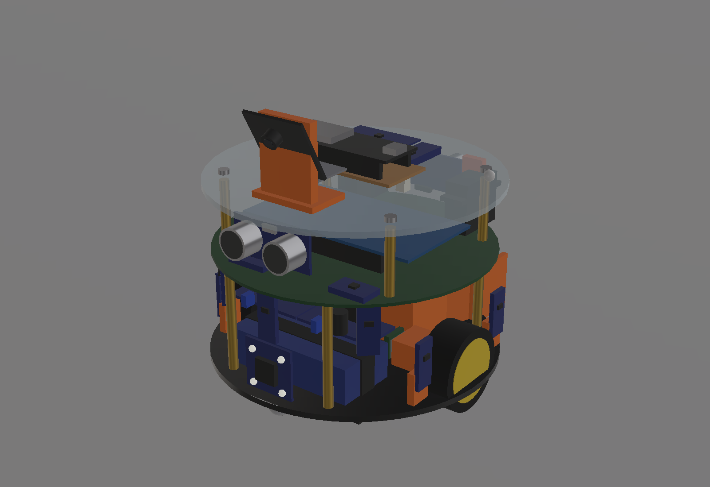
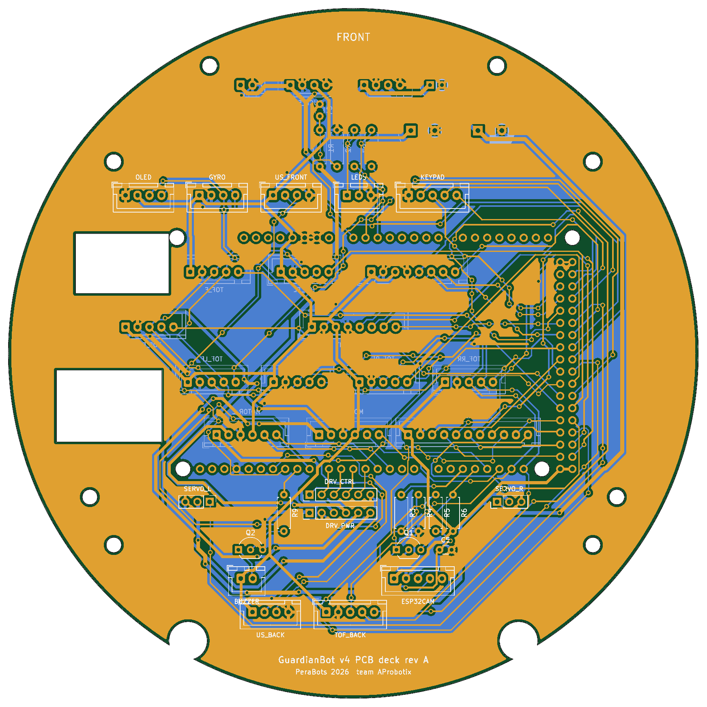
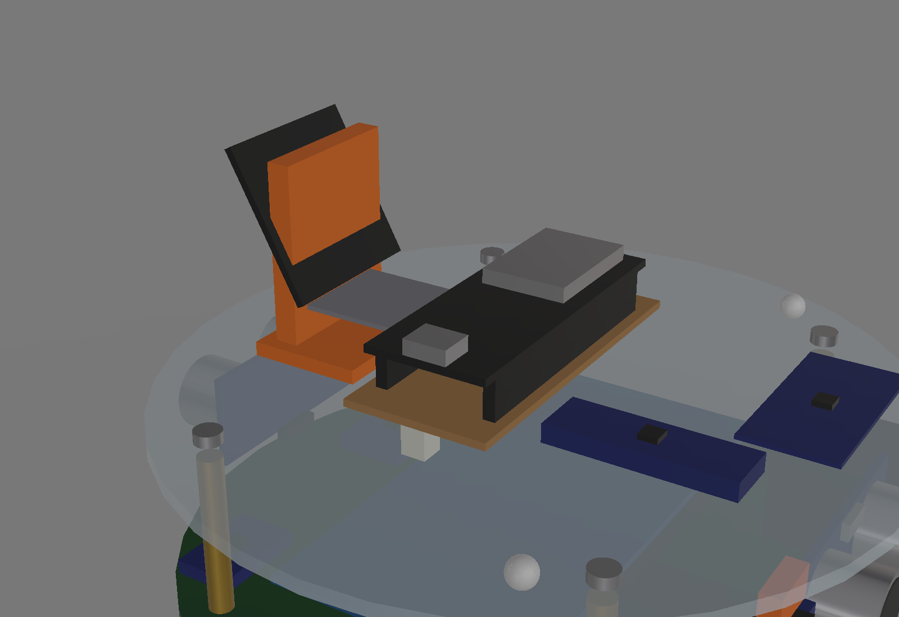

# GuardianBot v4.1 – final build guide

PeraBots 2026 University Final, *The Nine Seals of Pera*, team AProbotix.

v4.1 is built around the parts the team actually has. The brain is the team's own **ESP32-S3 N16R8** with the
**OV7670** camera, eight VL53L0X time-of-flight sensors give the distances, and a PCB is the robot's middle floor.
Nothing on the S3 side has to be bought, so the budget drops to about **Rs 15,900**. If the PCB can't be made,
a vero board does the same job (section 4).

v4.0 used an ESP32-CAM as brain and camera; it is kept in `versions/v4.0_esp32cam_pcbdeck/`.
The mission code, the Mega, the PCB deck and every sensor are the same in v4.1.



## 1. What changed from v3, and why

| v3 | v4.1 | Why |
|---|---|---|
| Mega + ESP32-S3 + separate ESP32-CAM | **Mega + ESP32-S3 N16R8 with the OV7670 on it** | The S3 runs the mission on core 1 and the camera on core 0 (its camera interface supports the OV7670). One board fewer and one link fewer than v3, and no ESP32-CAM to buy (v4.0 used one) |
| 5 Sharp IR + 4 HC-SR04 | **8 × VL53L0X + 2 × HC-SR04** | ToF sensors are accurate to about ±1 cm and don't care about colour. Two per side, 66 mm apart, so the robot measures its angle to a wall and straightens itself |
| 5-ch TCRT5000 | **Pololu QTR-8RC** | 8 sensors at 9.5 mm pitch: smoother line following and surer crossing detection |
| MPU6050 | **GY-50 L3G4200D gyro** | The MPU6050 is not available; only the Z rate is needed anyway |
| L298N + 12 V N20 + 3S | **DRV8833 + 6 V 300 rpm N20 + 2S LiPo** | The DRV8833 loses far less voltage than the L298N, and a 2S pack suits 6 V motors. PWM is capped at 80 % (≈ 6 V average) |
| START/CAL buttons | **1 × 4 keypad + 128 × 32 OLED** | The OLED shows the state and the key menu, so there is no guessing |
| Acrylic mid deck + Mega shield | **PCB mid deck** | All wiring is on the deck, with keyed plugs. It is lighter than acrylic plus a shield, and it lowers the centre of mass |

**Simulation results (Webots, 0 collisions in every run):**

| Run | Section 1 | Maze explored | END reached |
|---|---|---|---|
| Python controller, full mission (timed by the neutral judge) | 24.1 s | 61.6 s (3 blue + 2 green, correct) | **153.6 s** |
| ESP32-S3 brain firmware (software-in-the-loop, emulated Mega and camera), full mission | 33.2 s | 77.3 s | **175.6 s** |
| ESP32-S3 brain firmware, Section 3 restart with saved clues | | | **131.5 s** (from the restart) |
| Python controller with a **narrow 25° stock lens** instead of 52° | 24.1 s | 79.6 s (3 blue + 2 green, correct) | **171.6 s** |

The firmware runs now model the OV7670's grainier picture (5 % pixel noise), which costs about 5 s against v4.0
(170.3 s). A narrow stock lens still finds every clue, but the robot sees fewer tiles ahead and explores more:
about 18 s slower. A 90–120° M12 lens (≈ Rs 600) gets that time back.

## 2. Parts the team already has

| Part | Qty used | Job |
|---|---|---|
| Arduino Mega 2560 | 1 (+1 spare) | body: encoders, wheel PID, gyro, 8 ToF, line array, sonars, colour sensors, servos, keypad, OLED |
| ESP32-S3-DevKitC-1 **N16R8** (16 MB flash, 8 MB octal PSRAM) | 1 | brain: mission on core 1, camera on core 0 |
| OV7670 camera module (18-pin, no FIFO) | 1 | eye: 160 × 120 colour picture of the floor ahead |
| Pololu DRV8833 carrier | 1 | motor driver (both N20s) |
| N20 6 V 300 rpm encoder gear motors + 43 mm wheels | 2 | drive |
| 2S LiPo 7.4 V 1500 mAh | 1 | power (about 40 min of running) |
| HC-SR04 | 2 | long range front/back (Section 1 obstacle field) |
| Pololu QTR-8RC | 1 | Section 3 lines |
| TCS3200 | 2 | floor tiles / red zones, and the colour of a game piece |
| GY-50 L3G4200D | 1 | gyro Z |
| OLED 128 × 32 (I2C) | 1 | status + menu |
| 1 × 4 membrane keypad | 1 | GO / MAZE / S3 restart / CAL |
| Kpower M0170 servo | 2 | gripper arms |
| LM2596 buck + HW-319 buck | 1 + 1 | 5.0 V logic, 5.5 V servos |

**Not used in v4:** the L298N ×4 (they lose too much voltage), the 12 V N20 / 37D / SG90 motors, the 12 V 5200 mAh pack (too heavy), the 1602 LCD, the ESP-12E, the 2 Pololu IR sensors and 4 of the 6 HC-SR04. Keep the second Mega, a spare TCS3200 and two HC-SR04 as spares.

## 3. Shopping list (Sri Lanka, about Rs 15,900)

Prices are from tronic.lk in Nov 2026; "≈" marks an estimate. The VL53L0X is also listed at alphatronic.lk; if tronic.lk is out of stock, try there or the Pettah shops.

| # | Item | Qty | Price (LKR) | Have it? |
|---|---|---|---|---|
| 1 | **GY-VL53L0XV2 ToF sensor** (MD0140) | 8 | ≈4,800 (≈600 each) | |
| 2 | S3 carrier: 7 × 3 cm vero strip, 2 × 1×22 female headers (S3), 1×18 male header (camera ribbon), 2 × 4.7 kΩ (camera SIOD/SIOC pull-ups), 10 cm 18-wire female–female jumper ribbon, 15 cm 5-wire cable, 2 × M3 × 6 mm nylon spacers | 1 set | ≈300 | |
| 3 | *(optional)* M12 wide-angle lens (90–120°) if your OV7670's stock lens is narrower than 52° (measure it on the test page) | 1 | ≈600 | |
| 4 | **PCB mid deck, made by a local PCB shop** from `hardware/pcb_v4/guardianbot_v4_pcb_deck_gerbers.zip` (2 layers, 144 mm round, through-hole). Get a quote first | 1 | ≈4,500 | |
| 5 | JST-XH plug + socket sets: 2-pin ×2, 3-pin ×1, 4-pin ×6, 5-pin ×10, 6-pin ×2, 8-pin ×2, 11-pin ×1 (if there is no 11-pin, fit a 5-pin and a 6-pin side by side) | 24 | ≈1,200 | |
| 6 | Long male headers (≥ 20 mm pins) for the Mega: 8-pin ×6, 10-pin ×1, 2×18 ×1; 1×6 ×2 and 1×3 ×2 normal headers | 1 set | ≈500 | |
| 7 | Small parts: 2N7000, BC547, resistors (20k, 10k ×3, 3.3k, 1.8k, 1k, 330 ×2), 470 µF 16 V ×2, 100 µF 16 V, 100 nF ×2 | 1 set | ≈250 | |
| 8 | XT60 pair + 14 AWG wire, SPDT toggle switch 6 A, inline fuse holder + 5 A fuse | 1 set | ≈770 | |
| 9 | M3 threaded rod 1 m, M3 nuts/bolts, M2.5 and M2 bolts, M3 × 11 mm spacers ×4 (Mega) | 1 set | ≈700 | |
| 10 | 3 mm acrylic, 500 × 200 mm offcut (base + top deck; plywood works too) | 1 | ≈1,500 | |
| 11 | 5 mm blue + green LEDs, 5 V active buzzer | 1 set | ≈150 | |
| 12 | Silicone wire 20 AWG red + black, 26 AWG ribbon for the sensors, heat-shrink | 1 set | ≈900 | |
| 13 | Hook-and-loop strap (battery), foam tape (DRV8833, gyro, bucks) | 1 | ≈250 | |
| | **Total** (without the optional lens) | | **≈15,900** | |
| | **Vero-board fallback** (no PCB): replace rows 4–6 by a 9 × 15 cm vero board (≈300), female header strips (≈300) and the same JST sets (≈1,200), and cut `deck_mid_3mm_vero_fallback.dxf` from the acrylic | | **≈11,400** | |

## 4. The PCB mid deck



The middle floor is a 144 mm round, 2-layer, 1.6 mm FR4 board (`hardware/pcb_v4/`). The Arduino Mega plugs onto long male
headers **upside-down**, 11 mm above the deck, held by 4 × M3 × 11 mm spacers at its corner holes. Two cut-outs leave room for its USB-B
socket and DC jack.

- **Bottom side (wires go down to the base):**
  - 7 ToF sockets
  - QTR-8RC
  - both TCS3200
  - both motor + encoder sockets
  - battery input and both buck converters
  - bulk capacitors, battery divider, LED resistors
- **Top side:**
  - OLED, gyro, front sonar, LEDs, keypad (front)
  - DRV8833 wiring headers, link circuit, buzzer driver, brain link socket (silkscreen "ESP32CAM", the S3 uses it unchanged), back sonar, back ToF, servo headers (rear, between the gripper servos)

Every socket is labelled on the silkscreen (bottom labels are mirrored on the bottom silkscreen).
The `QTR-8RC` socket order is **VCC GND LEDON 1 2 3 4 5 6 7 8** (sensor 1 = the right-most). Crimp the QTR cable to match, because the sensor board's own pin order is different.

**Ordering:** send `guardianbot_v4_pcb_deck_gerbers.zip` and ask for "2 layers, 1.6 mm FR4, plated through holes, HASL, round
outline with internal cut-outs".

- **Design rules:**
  - tracks: 0.3 mm signal (0.2–0.25 mm on a few), 0.6–0.8 mm power
  - clearance: 0.25 mm, 0.2 mm minimum
  - 0.6 mm via drill, 1.0 mm pin holes
  - DRC: 0 errors, 0 unconnected
- **Making it yourself:** use the 1:1 masks `...-toner_TOP_copper_mirrored.pdf` and `...-toner_BOTTOM_copper.pdf`. Without plated holes, solder every via with a wire, and solder the pins on both sides where a track meets them on top.
- **Assembly:** use `...-assembly_top_silkscreen.pdf`, `...-assembly_bottom_silkscreen_mirrored.pdf` and `..._BOM.csv`.

**The DRV8833 carrier** is not soldered to the deck, because the pin order of the carrier you have may differ. Wire `DRV_CTRL`
(BIN2 BIN1 AIN2 AIN1 SLP GND) and `DRV_PWR` (VIN GND AOUT1 AOUT2 BOUT1 BOUT2) to the carrier by name. Stick the carrier
on foam tape behind the headers.

**Power path:**

```
2S LiPo ─ XT60 ─ 5 A fuse ─ switch ─ BAT_IN ─┬─ DRV_PWR VIN (DRV8833 VM) ── N20 left / right
                                             ├─ BUCK_5V   → LM2596 at 5.00 V → +5V: Mega 5V pins, ESP32-S3 (5V pin), all sensors
                                             ├─ BUCK_SERVO → HW-319 at 5.50 V → +5V5: 2 × M0170 (470 µF)
                                             └─ 20 k / 10 k → A0 (battery voltage)
```

Set both bucks **before** you plug anything in, and check them with a multimeter. The Mega gets 5 V on its 5V pins, so
never also feed it from USB with the motors running.

**Vero-board fallback:** cut `hardware/acrylic/deck_mid_3mm_vero_fallback.dxf`, which has the same outline and holes as
the PCB plus wire slots. Mount the Mega upside-down on it in the same place, and build the same circuit on a vero board,
using the schematic `guardianbot_v4_pcb_deck_schematic.pdf` and the connector table below.

### Arduino Mega pin map (`firmware/mega_body/pins.h`)

| Function | Pins |
|---|---|
| DRV8833 AIN1 / AIN2 (left), BIN1 / BIN2 (right), nSLEEP | D5 / D6, D7 / D8, D4 |
| Left encoder A, B / right encoder A, B | D2, D3 / D18, D19 |
| I2C bus: 8 × VL53L0X, L3G4200D (0x69), OLED (0x3C) | SDA D20, SCL D21 |
| VL53L0X XSHUT: front, FL, FR, LF, LR, RF, RR, back | D30 … D37 (open-drain: the Mega never drives them HIGH) |
| QTR-8RC sensors 1 (right-most) … 8, LEDON | D22 … D29 (PORTA), D38 |
| HC-SR04 TRIG front / back, ECHO front / back | D39 / D40, D10 / D11 |
| TCS3200 S2, S3 (shared) | D41, D42. S0 → 5 V, S1 → GND on both boards (wired on the PCB) |
| TCS3200 OUT floor / front, LED floor / front | D50 / D51, D43 / D44 |
| Servo left / right | D45 / D46 |
| Keypad K1 … K4 (to GND) | D47, D48, D49, D53 |
| LED blue / green, buzzer, battery | A1 / A2, D9, A0 |
| Link to the ESP32-S3 | TX2 D16 → divider → GPIO41; RX2 D17 ← 2N7000 ← GPIO42 |

### ESP32-S3 N16R8 and OV7670 (S3 flat on the top deck, camera on the mast)

The S3 lies **flat** on a 7 × 3 cm vero carrier on the top deck, just behind the camera mast (top-deck
holes at x = +5.5 mm, y = ±32.5 mm; 6 mm nylon spacers under the carrier so the solder joints clear the acrylic).

- **Mounting the S3:** it plugs face-up into two 1×22 female headers on the carrier. Its pins point down into the headers, so nothing sticks out and all the wiring is soldered underneath the carrier.
- **USB-C port:** faces the left edge of the robot (+y), so you can flash it without taking anything apart.
- **Camera ribbon:** a 1×18 male header on the front edge of the carrier takes a **10 cm 18-wire female–female ribbon** up to the OV7670 on the mast. Keep the ribbon flat and in one piece; don't split it into loose wires.
- **Link cable:** one 5-wire cable goes down through the slot to the deck's link socket (silkscreen `ESP32CAM`; the PCB is unchanged).
- **If the picture shows stripes or wrong colours:** lower `CAM_XCLK_HZ` in `cam_ov7670.h` from 10 MHz to 8 MHz and re-flash.



| Deck link socket pin | Goes to on the S3 |
|---|---|
| 1 +5V | 5V pin (powers the S3; its regulator makes 3.3 V) |
| 2 GND | GND |
| 3 ESP_RX (from Mega TX2, already divided to 3.2 V) | GPIO41 |
| 4 ESP_TX (to the 2N7000 → Mega RX2) | GPIO42 |
| 5 +3V3 (pull-up for the 2N7000 gate side) | 3V3 pin |

| OV7670 pin | S3 GPIO | | OV7670 pin | S3 GPIO |
|---|---|---|---|---|
| 3.3V | 3V3 | | D0 | 11 |
| GND | GND | | D1 | 9 |
| SIOC (SCL) | 5 + 4.7 kΩ to 3V3 | | D2 | 8 |
| SIOD (SDA) | 4 + 4.7 kΩ to 3V3 | | D3 | 10 |
| VSYNC | 6 | | D4 | 12 |
| HREF | 7 | | D5 | 18 |
| PCLK | 13 | | D6 | 17 |
| XCLK | 15 | | D7 | 16 |
| RESET | 3V3 (always running) | | PWDN | GND (always on) |

Pins the N16R8 must **not** use: GPIO 35, 36 and 37 (octal PSRAM), 19 and 20 (USB), 0, 3, 45 and 46 (boot
straps), 43 and 44 (the log port). The pin numbers are in `firmware/esp32s3_brain/cam_ov7670.h`.

**Check the camera before mounting it:** flash `firmware/esp32s3_testbench`, join the Wi-Fi network
`GuardianBot-test` and open http://192.168.4.1 (section 6). The Camera tab shows:
- the live picture;
- the 48 × 32 grid the brain uses, with colour classes;
- the camera ID (0x76);
- a helper that measures the lens's real field of view.

The maze code needs at least **52°**. If your lens is narrower, fit an M12 wide-angle lens (shopping row 3); see
the simulation result in section 1.

## 5. Mechanical build

Every file is generated from `hardware/cad/guardianbot_geometry.py`, the same numbers the Webots model uses.

- **Laser cut** (`hardware/acrylic/`): `deck_base_3mm.dxf` and `deck_top_3mm.dxf`. `sheet_layout.dxf` also has the vero-fallback mid deck.
  - **v4.1 changes:** the top deck has 2 new M3 holes for the S3 carrier, and its cable slot is 2 mm further forward.
  - The base deck's side-ToF post holes are fixed. In v4.0 they were 7 mm too far out, and two of them cut through the edge.
  - **Cut the v4.1 files, not the v4.0 ones.**
- **3D print** (`hardware/3d_prints/`), in PETG or PLA+, 0.2 mm layers, 4 walls, 40 % infill:

| Part | Qty | Notes |
|---|---|---|
| n20_clamp | 2 | M2.5 into the base |
| tof_post_40 | 4 | side ToF pairs, sensor 40 mm above the floor (sees the 50 mm pieces too) |
| tof_post_60 | 3 | front, front-left 45°, front-right 45° |
| tof_back_hanger | 1 | back ToF under the top deck, at 90 mm (sees over a piece held in the pocket) |
| hcsr04_hanger | 2 | front and back, under the top deck |
| servo_cradle | 2 | stands on the PCB deck, shaft down through the hub hole; one M3 up into the top deck |
| gripper_arm_left / right | 1 + 1 | servo horn screwed to the top plate; bicycle-tube strip in the groove |
| pocket | 1 | rear pocket on the base |
| tcs_front_bracket, tcs_floor_spacer ×2 | 1 + 2 | front and floor colour sensors |
| camera_mast | 1 | OV7670 lens 140 mm up, tilted 29° down. The foot is 24 mm long so it clears the front sonar hanger's nuts |
| caster_spacer | 1 | sand it until the robot sits level |
| deck_spacer_54p5 / deck_spacer_33p4 | 4 + 4 | on M3 threaded rod |

Build order:

1. **Base.**
   - Fit the motors, wheels, caster and the QTR-8RC (sensors 3–6 mm above the floor).
   - Fit the floor TCS3200, the 7 ToF posts, the front TCS bracket, the pocket and the LiPo.
   - Run every sensor cable up to the deck.
2. **PCB deck.**
   - Solder it, then stick the two bucks underneath at the front with foam tape.
   - Fit the Mega upside-down on its spacers and the DRV8833 carrier behind the headers.
   - Fit the gyro (flat, at the front right) and the servo cradles with the servos.
   - Centre the servos at 90° before you tighten the arm horns.
3. **Top deck.** Fit the camera mast, both sonar hangers, the back ToF hanger, the OLED, the keypad and the LEDs. Screw the empty S3 carrier down on its spacers, plug in the S3, then connect the camera ribbon and the link cable.

The robot weighs about 580 g, stands 152 mm tall at the mast, and nothing sticks out past the 150 mm circle.

## 6. Firmware, calibration and competition procedure

**Try it before you solder:**
- `simulation/wokwi/` runs the Mega firmware on a virtual Mega in Wokwi (like Tinkercad), with every sensor, the motors and a stand-in for the brain, all wired as on the PCB deck.
- `hardware/spice/` checks the deck's link circuit, battery divider and power rails.
- `simulation/worlds/testbench.wbt` serves the test-bench web page for the **simulated** robot: open it in Webots, press play, then browse to http://localhost:8080.

### The test-bench web page (`firmware/esp32s3_testbench`) – for testing only

Flash it to the S3 instead of the brain. Join the Wi-Fi network **GuardianBot-test** (password `aprobotix26`) and
open **http://192.168.4.1** on a phone or laptop. The OLED shows `TEST FIRMWARE WIFI ON`. The tabs are:

- **Sensors:** a radar view of the 8 ToF and 2 sonar beams, the QTR-8RC bars, both colour sensors with their class, gyro, encoders, battery, keys and link health.
- **Drive:**
  - a joystick (or W A S D), a speed limit and a big **STOP** button;
  - gripper servos, LEDs, buzzer, and odometry / gyro reset.
  - The robot stops if the page goes quiet for 0.3 s.
- **Camera:** the live picture, the brain's 48 × 32 grid with colour classes, white balance and the lens FOV helper.
- **Calibrate:**
  - **Drive 1 m:** gives `ENC_CPR`.
  - **Spin 360° on the gyro:** checks the gyro and the wheel track.
  - **Gripper angles** and **ToF offsets.**

  Everything is saved in the S3's flash, and the brain firmware loads it at start-up. Only `ENC_CPR` also has to be typed into `mega_body.ino`.
- **Log:** record up to 60 s of telemetry and download it as CSV.

**Rule 4.2:** Wi-Fi exists only in this test firmware. **Always re-flash `esp32s3_brain` before a run.**

See `firmware/README.md` for the boards, libraries and first power-up checklist. In short:

1. Flash `mega_body`. The OLED must show `ToF 8/8 gyro ok`.
2. Flash `esp32s3_testbench` and do the Calibrate tab. Set `ENC_CPR` in `mega_body.ino` too, then re-flash the Mega.
3. Flash `esp32s3_brain`. The OLED shows `READY 1:GO 3:S3 4:CAL`.
4. **Calibration time.** Press **K4** with white paper under and in front of the robot (colour sensors **and** camera). The robot must stay still for 1.5 s after power-on (gyro bias).
5. **Run.** Place the robot in START and press **K1**. It also starts correctly at the maze entrance.
   - **Section 3 restart:** place it in the maze exit cell facing the exit and press **K3**. It uses the clues saved in flash.
6. **Battery.** Change the LiPo below 3.6 V per cell; the OLED shows the voltage.
