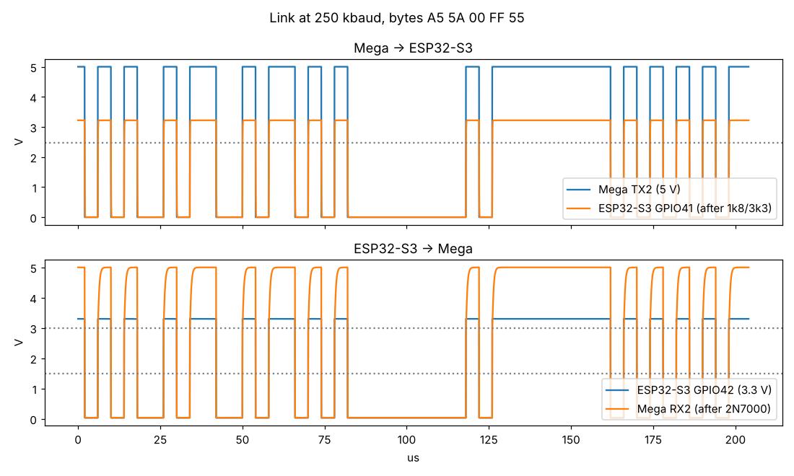
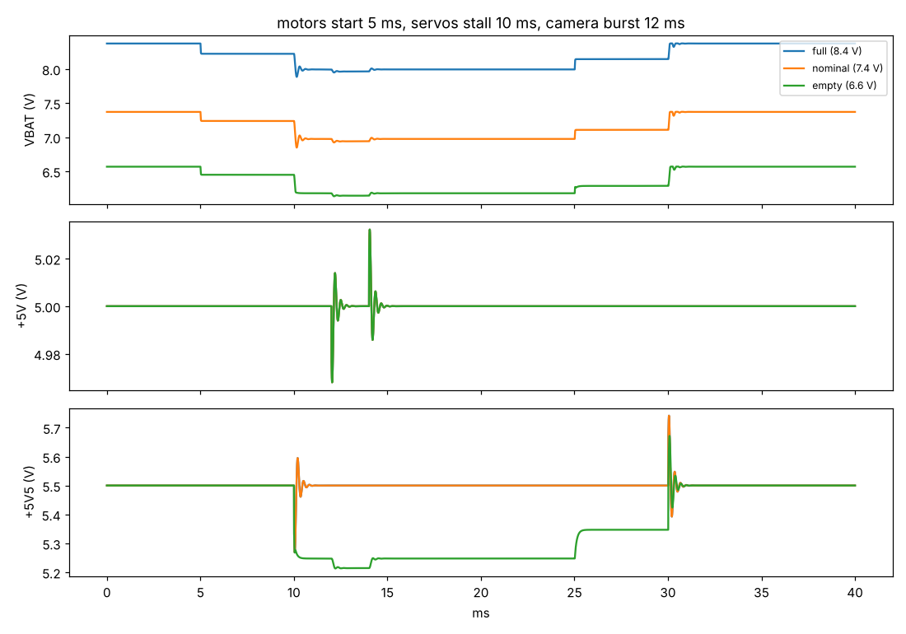

# SPICE checks of the PCB deck (ngspice)

Electrical checks of the circuits on the v4 PCB deck. Re-run with `python run_spice.py`
(needs ngspice, numpy, matplotlib). The values come from `hardware/cad/deck_v4/deck_design.py`;
the part models in `models.lib` are fitted to datasheet typical values. Every `*.cir` deck also
opens in KiCad's simulator or plain ngspice.

- **link_mega_to_esp / link_esp_to_mega**: the 250 kbaud link through the 1k8/3k3 divider and
  the 2N7000 level shifter, 30 cm cable. The bytes are decoded at mid-bit, as a UART samples them.
- **vbat_adc**: the 20k/10k + 100 nF battery divider on A0.
- **buzzer**: the BC547 driver.
- **power_full / nominal / empty**: the 2S LiPo and wiring feeding the DRV8833, both N20s starting from
  standstill, the logic buck with a camera burst, and the servo buck with both servos stalled at once.

| Check | Result | Limit | |
|---|---|---|---|
| Mega -> ESP: high level at GPIO15 | 3.22 V | 2.48 V (0.75 VDD) .. 3.6 V (abs max) | pass |
| Mega -> ESP: low level | 0.00 V | < 0.83 V (0.25 VDD) | pass |
| Mega -> ESP: rise time 10-90 % | 96 ns | < 400 ns (10 % of a 4 us bit) | pass |
| Mega -> ESP: bytes decoded at mid-bit | A5 5A 00 FF 55 | A5 5A 00 FF 55 | pass |
| ESP -> Mega: high level at RX2 | 5.00 V | > 3.0 V (0.6 VCC) | pass |
| ESP -> Mega: low level at RX2 | 0.04 V | < 1.5 V (0.3 VCC) | pass |
| ESP -> Mega: rise time 10-90 % (10k pull-up) | 0.58 us | < 1.0 us (25 % of a bit) | pass |
| ESP -> Mega: fall time 90-10 % | 8 ns | < 400 ns | pass |
| ESP -> Mega: bytes decoded at mid-bit | A5 5A 00 FF 55 | A5 5A 00 FF 55 | pass |
| Battery sense: A0 at 8.4 V (full 2S) | 2.800 V | < 5.0 V (ADC range) | pass |
| Battery sense: worst error 5..9 V (ADC steps) | 7 mV | < 50 mV | pass |
| Battery sense: source impedance at A0 | 6.7 kohm | < 10 kohm (ATmega2560 ADC) | pass |
| Battery sense: low-battery threshold 6.8 V reads | 6.79 V | 6.8 +- 0.05 V | pass |
| Battery sense: ADC sample kick-back on A0 | 0.70 mV | < 1 LSB (4.9 mV) | pass |
| Buzzer driver: Vce(sat) with 1k base resistor | 0.07 V | < 0.3 V (fully on) | pass |
| Buzzer driver: Ic / Ib (forced gain) | 29.5 mA / 4.23 mA | Ib > Ic / 50 | pass |
| Power, full battery: lowest VBAT at the deck | 7.88 V | > 6.0 V (DRV8833 min 2.7 V, bucks) | pass |
| Power, full battery: lowest +5V (logic) | 4.97 V | > 4.75 V (ESP32-S3, sensors) | pass |
| Power, full battery: lowest +5V5 (servos) | 5.27 V | > 4.8 V (M0170 min) | pass |
| Power, nominal battery: lowest VBAT at the deck | 6.85 V | > 6.0 V (DRV8833 min 2.7 V, bucks) | pass |
| Power, nominal battery: lowest +5V (logic) | 4.97 V | > 4.75 V (ESP32-S3, sensors) | pass |
| Power, nominal battery: lowest +5V5 (servos) | 5.27 V | > 4.8 V (M0170 min) | pass |
| Power, empty battery: lowest VBAT at the deck | 6.13 V | > 6.0 V (DRV8833 min 2.7 V, bucks) | pass |
| Power, empty battery: lowest +5V (logic) | 4.97 V | > 4.75 V (ESP32-S3, sensors) | pass |
| Power, empty battery: lowest +5V5 (servos) | 5.21 V | > 4.8 V (M0170 min) | pass |

**25 of 25 checks pass.**

With an empty pack (6.6 V), the servo buck runs in dropout while both servos stall:
+5V5 sags to about 5.2 V, which is still fine for the M0170. The logic rail never moves more than
a few tens of mV, so the Mega and the ESP32-S3 do not brown out when the motors or servos start.
